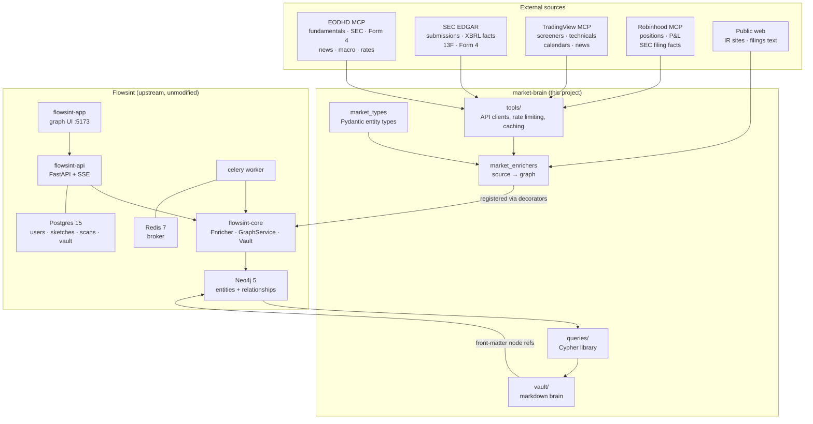
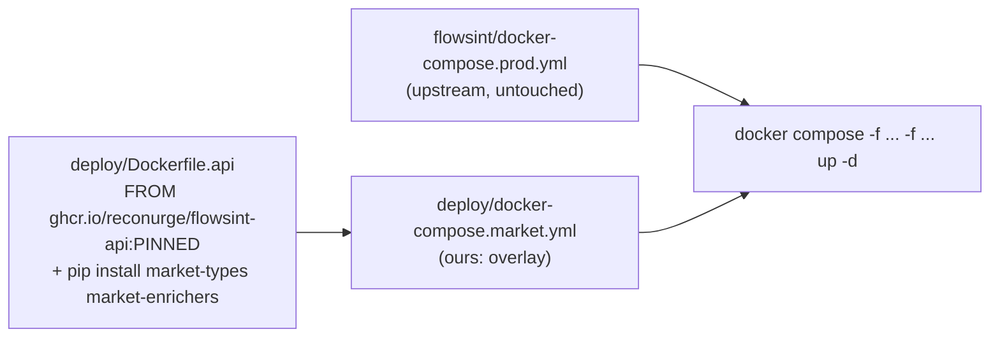
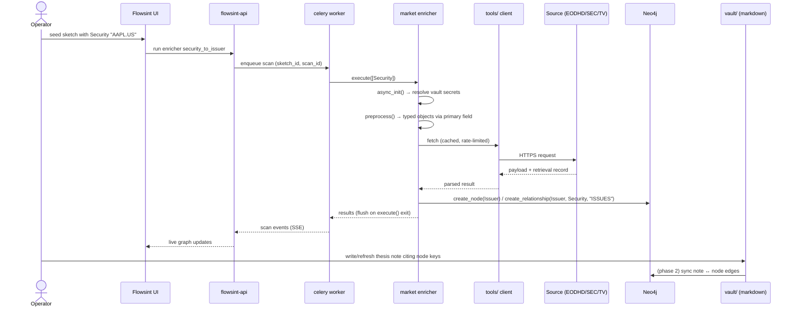

# 01 — Architecture

## System shape

Everything inside the `Flowsint` box is upstream and untouched. Everything inside `market-brain` is
ours. The seam is two decorators (`@flowsint_type`, `@flowsint_enricher`) and one base class
(`Enricher`) — see [02 — Flowsint primer](02-flowsint-primer.md) and
[ADR-0002](adr/0002-companion-repo-vs-fork.md).

## Components

### `market_types` — the ontology in code
Pydantic models subclassing `FlowsintType`, one file per entity, each decorated `@flowsint_type`, each
marking exactly one primary field as its merge key and defining a `compute_label` validator. Full
specification in [03 — Ontology](03-ontology.md).

### `market_enrichers` — one hop each
Enrichers subclassing `Enricher`, named `<input>_to_<output>`, laid out as
`<input_type>/to_<target>.py`. Each one does a single hop, writes typed nodes and labelled edges in
`postprocess()`, and attaches provenance to everything it writes. Catalog in
[05 — Enricher catalog](05-enricher-catalog.md).

### `tools/` — the only place that talks to the outside
Per upstream convention, external API wrappers live outside the enricher. This gives one home for the
things every source needs and no enricher should re-implement:

- **Rate limiting** per source (SEC's published limit is the binding one — [04](04-data-sources.md)).
- **Response caching** keyed by URL + params, with a TTL per data class (a 10-K never changes; a quote
  changes constantly). Caching is what makes re-running an enricher cheap, which is what makes
  re-running it *routine*.
- **Retrieval records**: every response that becomes graph data gets `source`, `endpoint`,
  `retrieved_at`, `request_hash` — the raw material for [08 — Provenance](08-provenance-and-trust.md).
- **Raw payload archiving** to disk, so a parse can be re-run without re-fetching, and a claim can be
  audited against exactly the bytes it came from.

### `queries/` — the research questions
Named, parameterised Cypher with expected output shape and a note on what the answer means. See
[07 — Query library](07-query-library.md).

### `vault/` — the brain layer
Markdown notes with YAML front matter that references graph nodes by merge key. Plain files in git, so
the reasoning survives any change of graph engine. See [06 — Workflow](06-second-brain-workflow.md).

## Deployment overlay

Upstream is consumed as **published images, pinned by `FLOWSINT_VERSION`** — never `latest`
([02 §4](02-flowsint-primer.md#4-runtime-and-deployment)). Our code reaches the runtime without forking:

Two candidate mechanisms, decided in phase 1 ([ADR-0003](adr/0003-type-registration-strategy.md)):

1. **Thin derived image** (expected choice): `FROM` the pinned upstream API image, install our two
   packages, reuse the upstream command. The overlay points `api` and `celery` at it. Both services
   need it — enrichers execute in the Celery worker, and the API needs the types to build schemas.
2. **Bind-mount + sitecustomize**: mount our packages in and force an import at interpreter start. No
   image build, but fragile and invisible in the image digest. Acceptable for dev only.

Whichever wins, the invariant is that `git diff` against upstream stays empty.

### Hardening deltas from upstream defaults
Applied in our overlay/env, not by editing upstream files:
- Regenerate `AUTH_SECRET`, `MASTER_VAULT_KEY_V1`, `NEO4J_PASSWORD` (never the `.env.example` values).
- Keep `5173` bound to localhost unless a reverse proxy with TLS sits in front, and keep the nginx
  Host-header allowlist tight.
- Review the `/var/run/docker.sock:ro` mount on `api`/`celery`; it is upstream's design, and it is a
  reason not to expose this stack to a network. See [09 — Security](09-security-and-secrets.md).

## Data flow: a research run end to end

Expansion is deliberately one hop at a time: a seed `Security` resolves to an `Issuer`, which fans out
to `Filing`, `InsiderTransaction`, `Holder`, `Person`, `SupplyRelationship`, each by its own enricher
with its own provenance. The operator chooses which hop to take, which keeps the graph small enough to
read and the citation trail intact.

## Scheduling

Phase 1 is manual, driven from the UI. Phase 4 adds a scheduler that runs maintenance hops and the
review queries ([11 — Roadmap](11-roadmap.md)):

| Cadence | Job |
|---|---|
| Daily | New filings for watchlist issuers; Form 4 sweep; news + sentiment refresh |
| Weekly | Thesis expectation check; catalyst horizon (next 30 days); position drift vs thesis; stale-node sweep |
| Quarterly | 13F holder refresh; fundamentals refresh; supply-chain re-extraction from new 10-K/10-Q |

Mechanism options: Flowsint's own Celery beat if upstream exposes it, else host cron calling the API,
else the scheduled-task facility of whichever Claude surface drives the review
([12 — Environment notes](12-environment-notes.md)).

## Where state lives

| State | Store | Backup |
|---|---|---|
| Entities, relationships, provenance | Neo4j (`neo4j_data_prod` volume) | `neo4j-admin dump` on a schedule; the graph is reconstructible from raw payloads + enrichers, but slowly |
| Users, sketches, scans, vault secrets | Postgres (`pg_data_prod`) | `pg_dump`; contains the encrypted vault, so treat the dump as a secret |
| Task queue | Redis | ephemeral, no backup |
| Notes, theses, queries, templates | this git repo | git remote |
| Raw API payloads | `tools/` archive directory | optional; large, re-fetchable, and licence-restricted for some sources ([10](10-compliance-and-ethics.md)) |

The asymmetry is intentional: **the notes layer is the part that must never depend on this
architecture.** Markdown in git outlives Neo4j, Flowsint and this project.

## Failure modes designed for

| Failure | Mitigation |
|---|---|
| Enricher exception → `execute()` returns `[]` silently ([02 §3](02-flowsint-primer.md#execution-pipeline)) | Per-item try/except with explicit logging; record a fetch outcome node property; the weekly review includes a "scans that produced nothing" query |
| Source outage or quota exhaustion | `tools/` cache serves last-known-good and marks the data stale rather than absent |
| Identity collision (two issuers merged onto one key) | Merge keys are registry identifiers, never tickers ([03](03-ontology.md#identity-resolution)); uniqueness constraints in Neo4j |
| Ticker reuse / re-listing after a change | `Security` carries validity dates; `get_symbol_change_history` is an ingestion input, not an afterthought |
| Upstream breaking change | `FLOWSINT_VERSION` pinned; our packages have contract tests against the pinned version |
| Stale graph passing as current | Every node carries `retrieved_at`; staleness is a first-class query ([08](08-provenance-and-trust.md)) |
