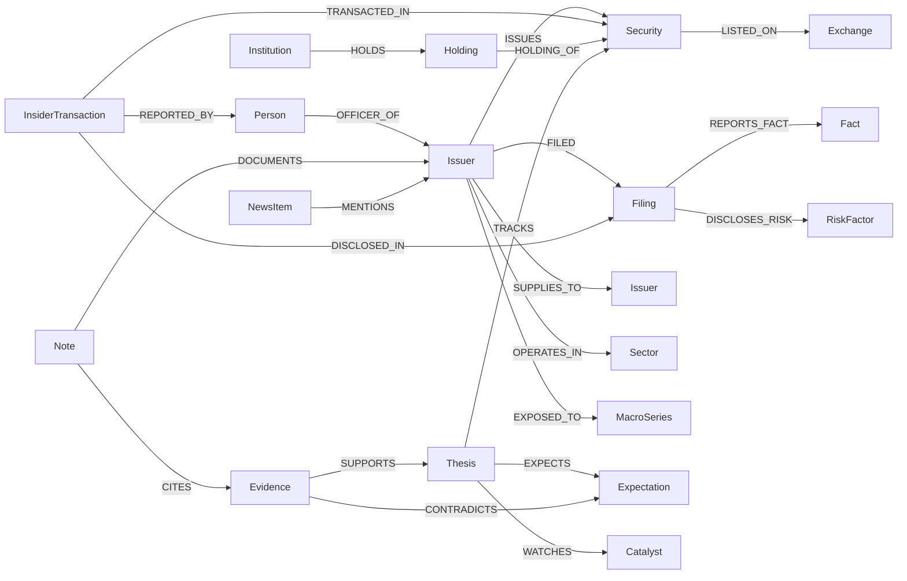

# 03 — Ontology

The ontology is the project. Enrichers can be rewritten in an afternoon; a wrong merge key corrupts
the graph permanently and silently. Everything here is normative: changing a **merge key** or
retiring a **relationship label** requires an ADR.

Mechanics this must obey (verified upstream — [02 — Flowsint primer](02-flowsint-primer.md)):

- Every type subclasses `FlowsintType`, is decorated `@flowsint_type`, and declares exactly one field
  with `json_schema_extra={"primary": True}` — **that field is the Neo4j merge key**.
- Every type defines `compute_label` (`@model_validator(mode="after")`) setting `nodeLabel`, handling
  `None` safely.
- `FlowsintType` allows extra keys, so we declare every property explicitly rather than relying on it.
- `GraphService` auto-adds `type`, `sketch_id`, `label`, `created_at` to every node — we never set those.
- Relationship labels are `UPPER_SNAKE_CASE` verbs; the `create_relationship()` default
  (`IS_RELATED_TO`) is never used.

## Identity resolution

The single hardest problem in a market graph, and the one tickers cannot solve.
`BRK.B` / `BRK-B` / `BRK.B.US` / `BRKb` are one security under four spellings; `FB` and `META` are one
issuer across a rename; `TWTR` is a ticker that now means nothing; and a 13F reports CUSIPs, not
symbols. So: **tickers are never merge keys. Registry identifiers are.**

| Entity | Merge key (`primary`) | Canonical form | Rationale |
|---|---|---|---|
| `Issuer` | `issuer_id` | `cik:0000320193` (10-digit zero-padded), else `lei:<20 char>`, else `slug:<normalized-name>` | CIK is stable across renames, ticker changes and re-listings; LEI covers non-SEC filers |
| `Security` | `security_id` | `figi:BBG000B9XRY4` when known, else `mic:XNAS:AAPL`, else `eodhd:AAPL.US` | FIGI is share-class precise and permanently assigned; MIC+symbol is the documented fallback |
| `Person` | `person_id` | `cik:0001214156` (Form 4 reporting owners have CIKs), else `slug:<name>@<issuer_id>` | Avoids collapsing two "John Smith" directors |
| `Institution` | `institution_id` | `cik:` of the 13F filer, else `lei:`, else `slug:` | 13F filers are CIK-identified |
| `Filing` | `accession` | `0000320193-24-000123` (dashed) | Globally unique per SEC filing |
| `InsiderTransaction` | `transaction_id` | `form4:<accession>:<seq>` | A Form 4 contains many transaction lines |
| `Holding` | `holding_id` | `13f:<filer_cik>:<period>:<cusip>` | One holder, one period, one issue |
| `Position` | `position_id` | `pos:<account_slug>:<security_id>` | Your own book; one row per security per account |
| `Fact` | `fact_id` | `xbrl:<cik>:<tag>:<unit>:<period>[:<accession>]` | XBRL facts restate; accession disambiguates vintages |
| `Catalyst` | `catalyst_id` | `cat:<issuer_id>:<YYYY-MM-DD>:<slug>` | Dated, issuer-scoped |
| `Thesis` | `thesis_id` | `thesis:<slug>` | Human-authored, stable |
| `Expectation` | `expectation_id` | `exp:<thesis_id>:<n>` | Ordered, falsifiable claims of a thesis |
| `Note` | `note_path` | repo-relative path, e.g. `vault/companies/aapl.md` | The file *is* the identity |
| `Evidence` | `evidence_id` | `ev:<sha256(source_ref + locator)[:16]>` | Content-addressed; same citation = same node |
| `MacroSeries` | `series_id` | `macro:<source>:<code>` e.g. `macro:ust:DGS10` | Source-qualified; two providers' "CPI" are not one series |
| `Sector` | `sector_id` | `gics:4510` when available, else `eodhd:Technology` | Taxonomy-qualified, never a bare string |
| `Segment` | `segment_id` | `seg:<issuer_id>:<slug>` | Reported segments are issuer-defined |
| `Exchange` | `mic` | `XNAS` | ISO 10383 |
| `Product` | `product_id` | `prod:<issuer_id>:<slug>` | Issuer-scoped, no global product registry |

**Cross-identity bridging.** When two nodes are later discovered to be the same real-world entity,
they are linked `SAME_AS` with provenance rather than silently merged; a nightly job can collapse
confirmed pairs. Recording the bridge keeps the evidence for *why* two things are one thing.

**Aliases, not keys.** `ticker`, `cusip`, `isin`, `sedol`, `former_name`, `eodhd_code`,
`tradingview_symbol` are all **indexed alias properties** on the node, never the merge key. Resolution
always runs alias → key, via the resolver enricher ([05](05-enricher-catalog.md)).

## Node types

Property tables list the fields we declare. `*` marks the primary/merge key. Every node also carries
the provenance block from [08 — Provenance](08-provenance-and-trust.md).

### Market core

#### `Issuer`
The legal entity that files and issues. Deliberately **not** upstream `Organization`, which is
specialised to the French SIRENE registry ([ADR-0004](adr/0004-separate-issuer-type.md)).

| Field | Type | Notes |
|---|---|---|
| `issuer_id`* | str | `cik:` / `lei:` / `slug:` |
| `cik`, `lei`, `name`, `former_names` | str, str, str, list[str] | `former_names` from `get_symbol_change_history` and SEC submissions |
| `sic`, `sic_description` | str | SEC classification as filed |
| `country_of_incorporation`, `fiscal_year_end` | str | |
| `hq_address`, `ir_url`, `website` | str | `website` is the bridge into Flowsint's native web enrichers |
| `employees`, `employees_as_of` | int, date | Always paired with its as-of date |
| `is_watchlist` | bool | Scope marker for scheduled jobs |

#### `Security`
A tradable instrument of an issuer; one node per share class.

| Field | Type | Notes |
|---|---|---|
| `security_id`* | str | `figi:` / `mic:<MIC>:<symbol>` / `eodhd:` |
| `figi`, `cusip`, `isin`, `sedol` | str | Indexed aliases |
| `ticker`, `eodhd_code`, `tradingview_symbol` | str | Per-source spellings, kept side by side |
| `security_type`, `share_class`, `currency` | str | `common` / `preferred` / `adr` / `etf` / `index` |
| `listed_from`, `listed_to`, `status` | date, date, str | Validity window — ticker reuse is real |
| `shares_outstanding`, `shares_as_of` | float, date | |

#### `Exchange`, `Sector`, `Segment`, `Product`
Context nodes. `Exchange(mic*, name, country, timezone)`;
`Sector(sector_id*, taxonomy, code, name, parent_sector_id)`;
`Segment(segment_id*, name, reported_in, revenue, revenue_period, basis)`;
`Product(product_id*, name, category, first_seen)`.

#### `Fact`
One reported financial datapoint, kept atomic and restatement-aware instead of dumping a statement blob.

| Field | Type | Notes |
|---|---|---|
| `fact_id`* | str | `xbrl:<cik>:<tag>:<unit>:<period>` |
| `tag`, `taxonomy`, `unit`, `value` | str, str, str, float | e.g. `Revenues`, `us-gaap`, `USD` |
| `period_start`, `period_end`, `instant` | date | Duration or instant facts |
| `fiscal_year`, `fiscal_period`, `form`, `frame` | int, str, str, str | `FY2025`/`Q3`, `10-K`, XBRL frame |
| `restates` | str | `fact_id` of the vintage this supersedes |

### Filings and disclosure

#### `Filing`
| Field | Type | Notes |
|---|---|---|
| `accession`* | str | `0000320193-24-000123` |
| `form_type`, `filed_at`, `period_of_report` | str, date, date | `10-K`, `10-Q`, `8-K`, `4`, `13F-HR`, `DEF 14A` |
| `primary_doc_url`, `filing_index_url` | str | The citation targets |
| `items`, `is_amendment`, `amends` | list[str], bool, str | 8-K item codes; amendment chain |
| `extracted_sections` | list[str] | Which sections we parsed (risk factors, MD&A, segments) |

#### `InsiderTransaction`
| Field | Type | Notes |
|---|---|---|
| `transaction_id`* | str | `form4:<accession>:<seq>` |
| `transaction_date`, `transaction_code`, `acquired_disposed` | date, str, str | `P`/`S`/`A`/`M`/`F`/`G`; `A`/`D` |
| `shares`, `price_per_share`, `value` | float | |
| `shares_owned_after`, `ownership_type` | float, str | direct / indirect |
| `is_10b5_1`, `footnotes` | bool, list[str] | A planned sale is not a signal; the flag matters |

#### `Holding` (13F) and `Position` (your book)
`Holding(holding_id*, period, cusip, shares, value, put_call, investment_discretion, shares_change, pct_of_portfolio)`.
`Position(position_id*, account, quantity, average_cost, market_value, unrealized_pnl, opened_at, as_of)` —
sourced read-only from the broker ([04](04-data-sources.md#d-robinhood-mcp)), never written back.

#### `Person` and `Institution`
`Person(person_id*, name, cik, titles, is_officer, is_director, is_ten_percent_owner, first_seen, last_seen)`.
`Institution(institution_id*, name, cik, institution_type, aum, aum_as_of)` — asset managers, index
funds, also the auditor and underwriter roles.

### News, macro, risk

- `NewsItem(news_id*, title, published_at, url, publisher, sentiment_polarity, sentiment_source, tickers_mentioned, summary)`
  — `news_id` is `sha256(url)[:16]`; **body text is not stored** ([10](10-compliance-and-ethics.md)).
- `MacroSeries(series_id*, source, code, name, unit, frequency, geography, last_observation_at)` and
  `Observation(observation_id*, series_id, period, value, revision_of)` — the series is a node, each
  value an observation, because macro data revises.
- `EconomicEvent(event_id*, name, country, scheduled_at, actual, consensus, previous, importance)`.
- `RiskFactor(risk_id*, issuer_id, category, summary, first_disclosed, last_disclosed, filing_accession)`
  — year-over-year risk-factor *changes* are the signal, so first/last disclosure dates are tracked.
- `SanctionsEntity(sanctions_id*, name, programs, source, listed_at)` — counterparty screening, from
  EODHD's sanctions endpoints.

### The brain layer

#### `Thesis`
| Field | Type | Notes |
|---|---|---|
| `thesis_id`* | str | `thesis:<slug>` |
| `title`, `direction`, `status` | str | `long` / `short` / `watch`; `draft`/`active`/`paused`/`closed`/`invalidated` |
| `conviction`, `conviction_history` | int (1-5), list | Dated conviction changes — you want the record of how you felt |
| `time_horizon`, `opened_at`, `closed_at` | str, date, date | |
| `summary`, `note_path` | str | `note_path` is the authoritative long form in markdown |
| `invalidation_summary` | str | Filled on close: what actually broke it |

#### `Expectation`
The falsification machinery. Without this, a thesis is a mood.

| Field | Type | Notes |
|---|---|---|
| `expectation_id`* | str | `exp:<thesis_id>:<n>` |
| `statement` | str | Must be checkable: "gross margin ≥ 42% in FY2026" |
| `metric`, `comparator`, `target_value`, `unit` | str, str, float, str | Machine-checkable where possible |
| `due_by`, `status`, `checked_at`, `observed_value` | date, str, date, float | `pending`/`met`/`missed`/`void` |
| `breaks_thesis` | bool | If missed, does the thesis die or just bend? Decided *before* the outcome |

#### `Catalyst`, `Note`, `Evidence`
- `Catalyst(catalyst_id*, title, catalyst_type, expected_at, date_confidence, status, outcome, outcome_at, importance)`
  — earnings, product launch, regulatory decision, lockup expiry, index rebalance, debt maturity.
- `Note(note_path*, title, note_type, created_at, updated_at, tags)` — mirror of a markdown file;
  the file is the source of truth, the node exists so notes are reachable *through* the graph.
- `Evidence(evidence_id*, claim, source, source_ref, locator, retrieved_at, excerpt, confidence, method)`
  — `locator` is page/section/line/XBRL tag; `excerpt` is short-quotation only.

## Relationship labels

Direction is normative — one direction per concept, no inverse duplicates.

| Label | From → To | Properties | Meaning |
|---|---|---|---|
| `ISSUES` | Issuer → Security | | share class of the issuer |
| `LISTED_ON` | Security → Exchange | `from`, `to`, `primary` | listing venue over time |
| `FILED` | Issuer → Filing | | filer relationship |
| `REPORTS_FACT` | Filing → Fact | | the filing a fact came from |
| `DISCLOSES_RISK` | Filing → RiskFactor | | |
| `REPORTS_SEGMENT` | Issuer → Segment | `period` | |
| `SELLS` | Issuer → Product | | |
| `OPERATES_IN` | Issuer → Sector | `taxonomy`, `is_primary` | |
| `OFFICER_OF` / `DIRECTOR_OF` | Person → Issuer | `title`, `from`, `to` | board and executive edges — shared-director queries live here |
| `REPORTED_BY` | InsiderTransaction → Person | | the reporting owner |
| `TRANSACTED_IN` | InsiderTransaction → Security | | |
| `DISCLOSED_IN` | InsiderTransaction → Filing | | the Form 4 citation |
| `HOLDS` | Institution → Holding | `period` | 13F reporter → line item |
| `HOLDING_OF` | Holding → Security | | resolved via CUSIP → security |
| `HELD_IN` | Position → Security | `account` | your own book |
| `SUPPLIES_TO` | Issuer → Issuer | `component`, `revenue_share`, `basis`, `since` | one direction only; "customer of" is this edge reversed |
| `COMPETES_WITH` | Issuer → Issuer | `basis`, `markets` | symmetric in meaning, stored once |
| `SUBSIDIARY_OF` | Issuer → Issuer | `pct_owned`, `as_of` | from Exhibit 21 |
| `AUDITED_BY` | Issuer → Institution | `fiscal_year` | auditor changes are a flag |
| `EXPOSED_TO` | Issuer/Sector → MacroSeries | `direction`, `sensitivity`, `basis` | derived, always carries its rule |
| `OBSERVED_AS` | MacroSeries → Observation | | |
| `AFFECTS` | EconomicEvent → Sector/Issuer | `expected_direction` | |
| `MENTIONS` | NewsItem → Issuer/Security/Person | `salience` | |
| `TRACKS` | Thesis → Security/Issuer | `weight` | what the thesis is about |
| `EXPECTS` | Thesis → Expectation | | |
| `WATCHES` | Thesis → Catalyst | | |
| `CATALYST_FOR` | Catalyst → Issuer/Security | | |
| `SUPPORTS` / `CONTRADICTS` | Evidence → Thesis/Expectation | `weight`, `assessed_at` | both directions of the argument are kept |
| `EVIDENCED_BY` | Expectation/Catalyst/edge-claim → Evidence | | the citation link |
| `DOCUMENTS` | Note → any node | | note ↔ graph bridge |
| `CITES` | Note → Evidence | | |
| `DERIVED_FROM` | any → any | `rule`, `derived_at` | inference provenance; never implicit |
| `SAME_AS` | any → same type | `confidence`, `basis` | identity bridging, not silent merging |
| `SCREENED_AGAINST` | Issuer/Person → SanctionsEntity | `match_score` | |

## Shape of the graph



## Constraints and indexes

Neo4j uniqueness on every merge key, plus indexes on the alias properties resolution walks through.
Where these live — our own migration step versus upstream `neo4j-migrations/` — is open question Q4 in
[02 §6](02-flowsint-primer.md#6-open-questions-to-resolve-in-phase-1). Flowsint lowercases class names
for Neo4j labels, so the label is `issuer`, not `Issuer`; **verify against a running instance before
writing migrations.**

```cypher
// merge keys
CREATE CONSTRAINT issuer_id   IF NOT EXISTS FOR (n:issuer)   REQUIRE n.issuer_id   IS UNIQUE;
CREATE CONSTRAINT security_id IF NOT EXISTS FOR (n:security) REQUIRE n.security_id IS UNIQUE;
CREATE CONSTRAINT filing_accn IF NOT EXISTS FOR (n:filing)   REQUIRE n.accession   IS UNIQUE;
CREATE CONSTRAINT person_id   IF NOT EXISTS FOR (n:person)   REQUIRE n.person_id   IS UNIQUE;
CREATE CONSTRAINT thesis_id   IF NOT EXISTS FOR (n:thesis)   REQUIRE n.thesis_id   IS UNIQUE;
// ... one per type in the tables above

// alias lookup paths
CREATE INDEX security_ticker IF NOT EXISTS FOR (n:security) ON (n.ticker);
CREATE INDEX security_cusip  IF NOT EXISTS FOR (n:security) ON (n.cusip);
CREATE INDEX security_isin   IF NOT EXISTS FOR (n:security) ON (n.isin);
CREATE INDEX issuer_cik      IF NOT EXISTS FOR (n:issuer)   ON (n.cik);
CREATE INDEX issuer_name     IF NOT EXISTS FOR (n:issuer)   ON (n.name);
CREATE INDEX fact_lookup     IF NOT EXISTS FOR (n:fact)     ON (n.tag, n.fiscal_year, n.fiscal_period);
CREATE INDEX filing_form     IF NOT EXISTS FOR (n:filing)   ON (n.form_type, n.filed_at);
CREATE INDEX prov_retrieved  IF NOT EXISTS FOR (n:issuer)   ON (n.retrieved_at);
```

## Conventions

1. **Dates are ISO-8601**; timestamps are UTC with explicit offset. Any `*_as_of` / `*_at` is required
   whenever a value can change.
2. **Money carries its currency.** Either a `currency` property or a `*_usd` suffix, never a bare number.
3. **No nested blobs where an edge belongs.** If it has identity, it is a node.
4. **No metric arithmetic at write time.** Store reported values; derive ratios in queries, so the
   derivation is visible and revisable.
5. **Every writing enricher sets provenance** ([08](08-provenance-and-trust.md)). No exceptions —
   including for nodes we create as placeholders during resolution.
