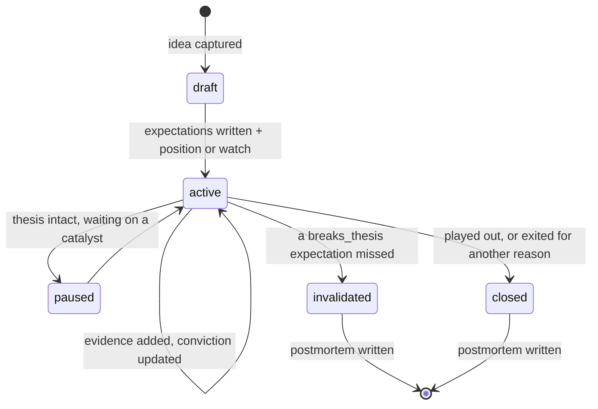

# 06 — Second brain workflow

The graph remembers facts and relationships. The brain layer holds the part that must stay human: what
you believe, why, what would prove you wrong, and what you learned when it did. It is plain markdown
in git — deliberately the least clever component in the system, because it has to outlive every other
one.

## Why markdown, not the graph

A thesis is prose with structure, versioned, diffable, and readable in any editor in twenty years.
Neo4j is excellent at relationships and poor at paragraphs; git is excellent at the history of a
paragraph. So: **prose in markdown, structure in front matter, relationships in the graph** — with
front matter as the join ([ADR-0005](adr/0005-notes-in-markdown.md)).

## Vault layout

```
vault/
├── companies/      aapl.md, tsm.md            one per issuer researched
├── theses/         tsm-advanced-node.md       one per thesis, the unit of conviction
├── catalysts/      2026-q4.md                 dated horizon logs
├── sectors/        semiconductors.md          sector/industry maps
├── macro/          rates.md, china-export.md  macro frames and what they imply
├── reviews/        2026-W42.md                weekly review output
├── postmortems/    tsm-2026-exit.md           closed positions, honestly
├── people/         officers.md                only public professional roles
└── inbox/          2026-10-16-random.md       unfiled capture; emptied at review
```

Flat directories with slug filenames: the filename *is* the note's identity
([03](03-ontology.md#identity-resolution)), so renames are deliberate events, not accidents.

## Front matter schema

Every note carries this block; `entities` is the bridge into the graph.

```yaml
---
title: TSMC — advanced node pricing power
note_type: thesis            # company | thesis | catalyst | sector | macro | review | postmortem | capture
created: 2026-10-16
updated: 2026-10-16
status: active               # draft | active | paused | closed | invalidated
tags: [semis, capex, pricing-power]
entities:                    # merge keys, exactly as the graph stores them
  - issuer:cik:0001046179
  - security:figi:BBG000BD8ZK0
  - sector:gics:4530
thesis:
  direction: long
  conviction: 4              # 1-5
  horizon: 18m
  opened: 2026-10-16
expectations:                # the falsification contract — see below
  - id: 1
    statement: "N2 contributes >= 10% of wafer revenue by FY2027 Q2"
    metric: n2_revenue_share
    comparator: ">="
    target: 0.10
    due_by: 2027-07-31
    breaks_thesis: true
    status: pending
sources:                     # citations; mirrored into Evidence nodes
  - ref: "https://www.sec.gov/Archives/edgar/data/1046179/..."
    locator: "20-F 2025, Item 5A"
    claim: "Advanced nodes were 69% of wafer revenue in 2025"
---
```

The front matter is machine-read by `note_to_entities` and `thesis_to_expectations`
([05](05-enricher-catalog.md)), which create `Note`, `Thesis` and `Expectation` nodes and the
`DOCUMENTS` / `EXPECTS` / `CITES` edges. **The file stays authoritative**; the graph holds a mirror so
notes are reachable by traversal ("every note touching this supplier").

## Thesis lifecycle



Rules that make the loop real:

1. **No thesis goes `active` without at least one `breaks_thesis: true` expectation.** If nothing could
   falsify it, it is a feeling, and the system will treat it as one (`status: draft`).
2. **Expectations are written before the outcome is known**, with a due date. Retrofitting an
   expectation after the fact is the single most common way a research journal becomes useless.
3. **Conviction changes are appended, not overwritten** — `conviction_history` keeps the record of how
   you felt and when, which is what a post-mortem actually needs.
4. **Contradicting evidence is linked, not buried.** `CONTRADICTS` edges are the ones that earn the
   system its keep; a thesis with zero contradicting evidence is under-researched, and the weekly
   review flags it.
5. **Every closed or invalidated thesis gets a post-mortem** within a week: what the thesis was, which
   expectation broke, how early the graph knew, and what query would have surfaced it sooner. That
   last question is how the query library grows.

## Capture → process → connect → review

Classic second-brain mechanics, adapted so the graph does the connecting:

| Stage | What happens | Where |
|---|---|---|
| **Capture** | Anything interesting lands in `inbox/` with a date and a source link. No structure required — friction here kills the habit | `vault/inbox/` |
| **Process** | At review: each capture becomes evidence on an existing thesis, a new draft thesis, a catalyst, or is deleted. Nothing stays in the inbox | `vault/` |
| **Connect** | Seed the entity into the graph and run the relevant hops; the graph suggests the neighbours you did not think of | Flowsint UI |
| **Review** | Scheduled queries produce the week's agenda; the review note records decisions | `vault/reviews/` |

The asymmetry with a plain note system: **you are not responsible for remembering connections.** You
are responsible for seeding entities and recording reasoning. Connections are a query.

## Weekly review (the system's heartbeat)

Driven by queries, not memory. Each item below is a named query in
[07 — Query library](07-query-library.md); the output is pasted into `vault/reviews/YYYY-Www.md` with
decisions appended.

1. **Breached expectations** — any `Expectation` past `due_by`, or whose observed value crossed the target.
2. **Catalyst horizon** — everything due in the next 30 days across tracked issuers.
3. **Insider activity** — Form 4 clusters in the last 14 days on tracked issuers, `10b5-1` flagged separately.
4. **New filings** — 8-K items, amendments, auditor changes, officer departures.
5. **Unbalanced theses** — active theses with no `CONTRADICTS` evidence, or none added in 60 days.
6. **Stale nodes** — core properties older than their TTL ([08](08-provenance-and-trust.md)).
7. **Conflicts** — same fact, two sources, different values.
8. **Concentration check** — holdings sharing a supplier, customer, end market or macro exposure.
9. **Inbox** — empty it.
10. **Scans that produced nothing** — enrichers returning zero results, which usually means a broken
    source rather than an empty world ([02 §3](02-flowsint-primer.md#execution-pipeline)).

Quarterly, additionally: 13F holder refresh, fundamentals refresh, risk-factor diffs on new 10-K/10-Q,
and a re-read of every active thesis against its original text.

## Sketches: how to scope an investigation

A Flowsint **sketch** is an investigation workspace, and `sketch_id` is stamped on every node written
([02](02-flowsint-primer.md)). Exactly how sketches isolate data is open question Q5 — but the
intended usage is:

- **One sketch per research theme** (`semis-advanced-nodes`, `us-rates-sensitives`) for exploratory work.
- **One long-lived `core` sketch** holding watchlist issuers and their maintained spine.
- Promotion from theme sketch to `core` is a deliberate act, which keeps exploratory noise out of the
  maintained graph.

## Note types at a glance

| Type | Answers | Lives |
|---|---|---|
| `company` | What is this business, how does it make money, what breaks it | `companies/` |
| `thesis` | What I believe, why, what falsifies it, what I expect by when | `theses/` |
| `catalyst` | What happens on which date and what each outcome implies | `catalysts/` |
| `sector` | Structure, cycle position, who wins, shared dependencies | `sectors/` |
| `macro` | A frame (rates, FX, a policy regime) and which holdings it bears on | `macro/` |
| `review` | This week's queries, decisions, changes | `reviews/` |
| `postmortem` | What I got wrong, when the graph knew, which query I now run | `postmortems/` |

Templates for each live in [`templates/`](../templates/).
